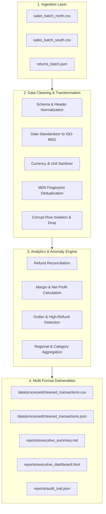

# 🚀 DataFlow Automator: Enterprise Multi-Source Ingestion, Transformation & Executive Reporting Pipeline

[-success.svg)](#)
[](#)
[](#)
[](#)

> **Task Submission:** Automated workflow system designed for automated file processing, dirty data transformation, and multi-format executive report generation.

---

## 📌 1. Project Overview & Problem Statement

### The Problem (Manual Repetitive Workflow)
In retail, e-commerce, and logistics operations, decentralized branches submit daily transaction batches in disparate, messy formats (multiple CSV files with unaligned headers, varied date formats like `DD/MM/YYYY` vs `YYYY-MM-DD`, currency symbols, whitespace errors, negative/invalid quantities, and separate JSON return logs). 

Manual reconciliation takes **2–3 hours daily**:
* Manually copying and pasting between spreadsheets.
* Identifying and removing duplicate transaction entries.
* Cross-referencing return/refund requests against initial orders.
* Calculating regional KPIs, category volumes, and profit margins.
* Generating executive presentation reports.

### The Automated Solution (`DataFlow Automator`)
This project provides an **end-to-end automated data pipeline** that executes in milliseconds:
1. **Batch Ingestion:** Ingests heterogeneous data files (`.csv`, `.json`) from an incoming directory.
2. **Data Cleaning & Deduplication:** Cleans strings, normalizes dates to ISO-8601, strips currency symbols, drops corrupt rows, and eliminates duplicates using cryptographic transaction fingerprinting.
3. **Reconciliation & Enrichment:** Merges sales transactions with refund logs, derives net revenue, taxes, and profit margins.
4. **Statistical Analysis & Anomaly Detection:** Calculates KPIs and flags outlier orders or branches with abnormal return rates.
5. **Multi-Format Export & Reporting:** Automatically outputs standardized CSV/JSON datasets, an **interactive HTML dashboard** with embedded SVG analytics, an **Executive Markdown scorecard**, and an **Audit Trail Log**.
6. **Watch Daemon:** Monitors the input folder for newly dropped batch files and re-runs instantly.

---

## 🏗️ 2. System Architecture & Workflow Pipeline



---

## ✨ 3. Core Features & Capabilities

* **Zero External Dependencies:** Built 100% using native standard libraries in both **Node.js** (`fs`, `path`, `crypto`) and **Python 3** (`csv`, `json`, `datetime`, `hashlib`, `pathlib`). Runs out-of-the-box on any machine without `pip install` or `npm install`.
* **Dual Runtime Implementations:** Complete, interchangeable implementations provided in both `automate.js` and `automate.py`.
* **Cryptographic Deduplication:** Hashes transaction composites (`order_id + cust_id + product + price + qty`) to prevent double-counting.
* **Fault Tolerant:** Corrupted rows (negative amounts, missing IDs, unparseable dates) are logged to an audit report without crashing the batch.
* **Interactive HTML Dashboard:** Modern glassmorphism UI with responsive metric cards, top products leaderboard, and dynamic pure-SVG revenue charts.
* **Audit Trail & Governance:** Produces detailed JSON execution logs showing row counts, validation pass rates, processing times, and exact reasons for dropped rows.
* **File Watcher Daemon Mode:** Run with `--watch` to monitor incoming directories in real-time.

---

## 📂 4. Project Structure

```text
automation_workflow_system/
├── README.md                          # Comprehensive documentation & submission details
├── config.json                        # Configurable business thresholds & aliases
├── package.json                       # Node metadata and npm scripts
├── automate.js                        # Complete Node.js automation pipeline
├── automate.py                        # Complete Python 3 automation pipeline
├── test_pipeline.js                   # Node automated test suite (5 assertions)
├── test_pipeline.py                   # Python automated test suite
├── run.bat                            # 1-click execution script for Windows
├── run.sh                             # 1-click execution script for Linux/macOS
├── .gitignore                         # Standard git ignore rules
├── data/
│   ├── raw/                           # Raw incoming batch files
│   │   ├── sales_batch_north.csv      # Sample batch with dirty dates & currency symbols
│   │   ├── sales_batch_south.csv      # Regional batch with distinct column aliases
│   │   └── returns_batch.json         # Customer refund & cancellation records
│   └── processed/                     # Cleaned, standardized warehouse-ready outputs
│       ├── cleaned_transactions.csv   # Standardized, sanitized CSV dataset
│       └── cleaned_transactions.json  # Structured JSON dataset
└── reports/                           # Generated multi-format executive reports
    ├── executive_summary.md           # Formatted Markdown report with KPI scorecard
    ├── executive_dashboard.html       # Standalone interactive HTML dashboard
    └── audit_trail.json               # Full execution audit log & anomaly flags
```

---

## ⚡ 5. How to Run the Automation

### Quick Start (Automatic Runtime Detection)

* **Windows:**
  ```cmd
  run.bat
  ```

* **Linux / macOS:**
  ```bash
  chmod +x run.sh
  ./run.sh
  ```

---

### Running with Node.js

1. **Execute full pipeline:**
   ```bash
   node automate.js
   ```

2. **Generate fresh sample messy test data:**
   ```bash
   node automate.js --generate-mock
   ```

3. **Start in Watch Mode (auto-process on file drop):**
   ```bash
   node automate.js --watch
   ```

4. **Run Automated Test Suite:**
   ```bash
   npm test
   # or
   node test_pipeline.js
   ```

---

### Running with Python 3

1. **Execute full pipeline:**
   ```bash
   python automate.py
   # or
   python3 automate.py
   ```

2. **Generate mock data:**
   ```bash
   python automate.py --generate-mock
   ```

3. **Run Automated Test Suite:**
   ```bash
   python test_pipeline.py
   ```

---

## 📊 6. Sample Output Showcase

### 1. Executive Summary Markdown (`reports/executive_summary.md`)
```markdown
# 📊 Executive Business Intelligence & Data Quality Report
**Pipeline Run Duration:** 7 ms | **Status:** ✅ Successfully Processed

## 🚀 Key Performance Indicators (KPI Scorecard)
| Metric | Value | Status / Benchmark |
| :--- | :--- | :--- |
| **Gross Invoiced Revenue** | **$10,871.20** | Raw sales volume |
| **Net Realized Revenue** | **$10,426.20** | After refunds & adjustments |
| **Total Net Profit** | **$3,181.20** | Operating gross profit |
| **Overall Profit Margin** | **30.51%** | 🟢 Healthy Margin |
| **Total Orders Fulfilled** | **17** orders | Ingested & Validated |
| **Average Order Value** | **$613.31** | Net revenue per transaction |
| **Total Refund Amount** | **$445.00** | 4.1% of gross |
```

### 2. Interactive Executive HTML Dashboard (`reports/executive_dashboard.html`)
Open `reports/executive_dashboard.html` in any browser to view:
* **Metric Cards:** Gross Sales, Net Realized Revenue, Net Profit, Average Order Value (AOV).
* **Pure SVG Visualizations:** Net Revenue distribution by Department / Category.
* **Leaderboard:** Top 5 revenue-generating items with unit volumes.
* **Audit Health Meter:** Data hygiene pass rate & anomaly alerts.

### 3. Execution Audit Log (`reports/audit_trail.json`)
```json
{
  "pipeline_version": "1.0.0",
  "records_ingested": 21,
  "records_valid": 17,
  "duplicates_dropped": 1,
  "corrupted_records_dropped": 3,
  "anomalies_detected": [
    {
      "type": "HIGH_VALUE_ORDER",
      "order_id": "ORD-1005",
      "amount": 2850,
      "threshold": 2000,
      "description": "Order ORD-1005 exceeds high-value threshold ($2850)"
    }
  ]
}
```

---

## 🧪 7. Verification & Automated Tests

Run the test suite to verify all data cleaning algorithms, deduplication logic, and report generation:

```bash
node test_pipeline.js
```

**Test Coverage:**
* `Test 1`: Date standardization across `YYYY-MM-DD`, `DD/MM/YYYY`, `YYYY/MM/DD`, and string dates.
* `Test 2`: Currency sanitizer (removes `$`, commas, whitespace, parses valid floating numbers).
* `Test 3`: Category normalizer (resolves alias mappings e.g. `elec` $\to$ `Electronics`).
* `Test 4`: Full pipeline end-to-end execution, deduplication filter, and metric accuracy.
* `Test 5`: File generation verification for CSV, JSON, Markdown, and HTML reports.
